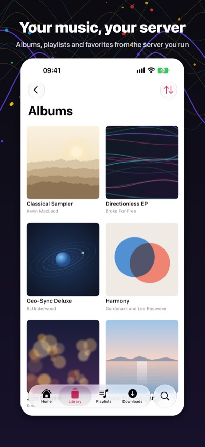
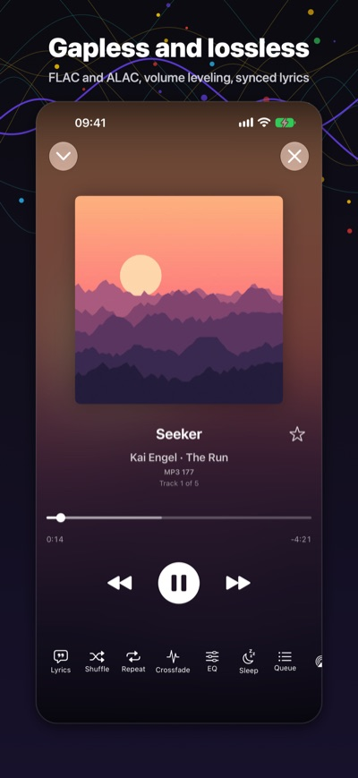
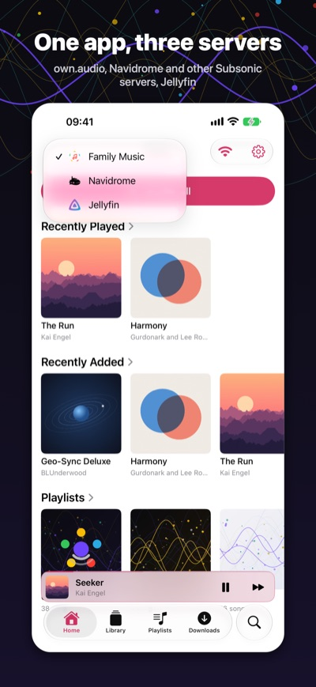
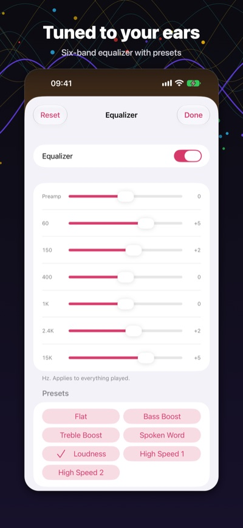

<p align="center">
  
</p>

<h1 align="center">own.audio Music</h1>

<p align="center">A native music player for iPhone and iPad that plays from your own server.</p>

<p align="center">
  <a href="https://apps.apple.com/app/own-audio-music/id6821355751"></a>
</p>

<p align="center">
  <a href="https://apps.apple.com/app/own-audio-music/id6821355751">App Store</a> ·
  <a href="https://own-audio.github.io/music-ios/">User guide</a> ·
  <a href="https://www.own.audio">Website</a> ·
  <a href="PRIVACY.md">Privacy</a> ·
  <a href="CHANGELOG.md">Changelog</a> ·
  <a href="https://github.com/own-audio/music-ios/issues">Report a problem</a>
</p>

<p align="center">
  
  
  
  
</p>

A native iPhone and iPad music player for your own server: **own.audio, Navidrome and
Jellyfin**, side by side in one app.
Swift and SwiftUI, no web views, no third-party dependencies — a few megabytes.

Free on the App Store for iPhone and iPad since 6 November 2026; runs on iOS 18 and later.

## What it does

- Gapless playback and crossfade, on AVAudioEngine
- Streams while it downloads, with its own Core Audio decoder
- Downloads and an offline mode: with no network it shows and plays what is on the phone
- Synced lyrics, volume leveling, equalizer
- Favorites, ratings, playlists, play reporting
- Several servers at once, each with its home and outside addresses; iPad; CarPlay
- With own.audio: smart playlists, identifying the library with MusicBrainz, and a library on
  the phone that follows the server's changes
- English and Czech

## Why you can trust it

- **It collects nothing.** No account with us, no analytics, no ads, no tracking. The App
  Store privacy label says "Data Not Collected", and [PRIVACY.md](PRIVACY.md) lists the
  only places the app talks to: the servers you add, and Apple or Google if you sign in with
  them.
- **The code is all here.** Every line of the app is in this repository under the
  [MPL-2.0](LICENSE), with no third-party dependencies — only Apple's frameworks and the
  packages in `Packages/`. The App Store builds come from this repository with
  `scripts/testflight.sh`, and the build number is the commit count.
- **Your library stays yours.** The app plays from your server; your files are not copied
  anywhere else. Downloads stay on the phone and are removed with the app.
- **Free, with nothing to unlock.** No in-app purchases and no subscription. The only paid
  thing in own.audio is the optional hosted storage at [own.audio](https://www.own.audio),
  paid on the website.
- **Try it before you set anything up.** "Try the Demo Library" on the first screen signs
  in to a public demo server, no account needed.
- **Made by a person you can reach.** own.audio Music is built by
  [Kornel Maráz](https://www.own.audio/about/). Problems and questions go to
  [the issues](https://github.com/own-audio/music-ios/issues), or to hello@own.audio.

## Build

The plan is in [IMPLEMENTATION_PLAN.md](IMPLEMENTATION_PLAN.md).

Developed with Xcode 27 and [XcodeGen](https://github.com/yonaskolb/XcodeGen); runs on iOS 18
and later.

```bash
brew install xcodegen
xcodegen generate
open OwnAudioMusic.xcodeproj
```

The packages test on their own (`swift test` in each). Tests against real servers and the UI
tests are described in [CLAUDE.md](CLAUDE.md).

## Layout

- `App/` — the app
- `Packages/SubsonicKit` — Subsonic/OpenSubsonic client
- `Packages/OwnAudioKit` — own.audio's own API (`/api/v2`)
- `Packages/JellyfinKit` — Jellyfin client
- `Packages/PlayerEngine` — the player (`MusicEngine`, `PlayerCore`); knows nothing about servers
- `UITests/` — end-to-end tests against real servers
- `docs/history/` — plans and changelogs of the projects merged into this one

## Privacy

The app collects nothing and talks only to the servers you add: [PRIVACY.md](PRIVACY.md).

## License

[MPL-2.0](LICENSE). Changes are listed in [CHANGELOG.md](CHANGELOG.md).

The Jellyfin logo (`App/OwnAudioMusic/Assets.xcassets/JellyfinLogo.imageset`) marks Jellyfin
servers in the server list. It is © the Jellyfin contributors, from
[jellyfin-ux](https://github.com/jellyfin/jellyfin-ux), under
[CC BY-SA 4.0](https://creativecommons.org/licenses/by-sa/4.0/), used as the project's
[branding guide](https://jellyfin.org/docs/general/contributing/branding/) allows: to show
that the app works with Jellyfin, not as this app's logo.

The OpenSubsonic logo (`App/OwnAudioMusic/Assets.xcassets/OpenSubsonicLogo.imageset`) marks
Subsonic servers the same way. It comes from
[open-subsonic-api](https://github.com/opensubsonic/open-subsonic-api) (`assets/icons/logo.svg`),
licensed under [Apache-2.0](https://www.apache.org/licenses/LICENSE-2.0).
