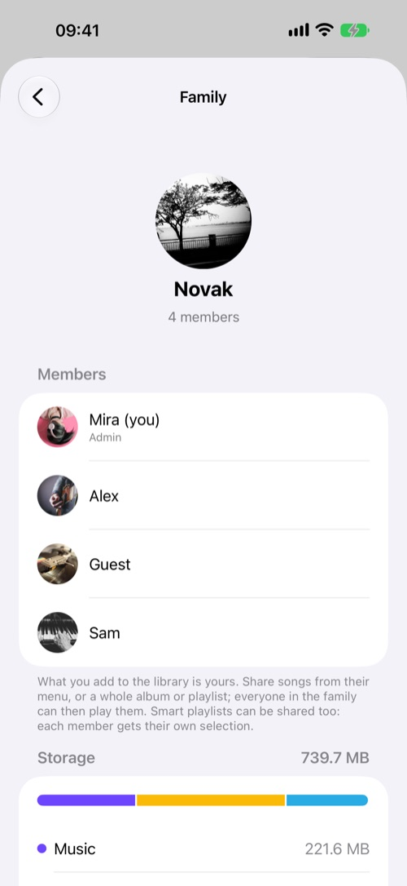

# Family and your own.audio account
{: .no_toc }

1. TOC
{:toc}

On own.audio, a library belongs to a family: several people on one server, each with their own
account. The pages here are on the server's page in Settings (**Settings → your server**), and
only for own.audio servers the app talks to through own.audio's own API.

## Family

{: width="300"}

**Family** (shown for the server in use) has:

- the family's picture, name and number of members;
- **Members**: everyone in the family, with **Admin** next to the family's admin and
  **Invited** for someone who hasn't joined yet;
- **Storage**: how much the family keeps, split into **Music**, **Audiobooks** and **Podcasts**;
- **Credit**, where the server is paid for: the **Balance**, **A Month at Today's Storage** and
  how long the credit **Lasts About**. Storage is paid from the family's prepaid credit, day by
  day. Topping it up is not done in the app.

### Inviting someone

The family's admin sees **Invitations**. **Invite Someone** makes an invitation: a code for one
person, shown with a QR code of its link and **Share Invitation**. They sign in to the same
server and enter the code, or open its link. Tap an invitation to show it again; **Withdraw**,
in its menu or by swiping it, cancels it.

### Joining another family

**Join Another Family…** asks for the code from that family's admin. Joining means leaving this
family: what the other family's members share appears instead of what this one shares.

## Sharing

What you add to the library is yours. Nothing is shared until you share it, and "not shared"
only means the others don't see it; nothing is locked.

- A song: **Share with the Family** or **Stop Sharing** in its menu.
- An album: **Share My Songs with the Family** or **Stop Sharing My Songs** in its **More**
  menu. This covers your own songs on it.
- A playlist of yours: **Share with the Family** or **Stop Sharing** in its menu.
- A smart playlist: **Share with the Family** in its rule. Each member then gets their own
  selection, from what they have listened to.

Songs shared with the family have a small people icon in song lists.

## Covers and pictures

On own.audio you can give your own songs, albums and playlists, and artists, a picture from
your photos: **Choose Cover…**, **Choose Album Cover…** or **Choose Picture…** in their menus. The
app uses the system photo picker, which doesn't need access to your whole photo library, and
sends the picture to the server at most 1600 pixels on its longest side.

## Devices

**Devices** lists every device signed in to your account, with **This device** marked, and when
each was last used. Swipe a device, or open its menu, to **Sign Out** of it. **Sign Out
Everywhere** ends every session, this device's too, and asks for a fresh sign-in.

## Listening

**Listening** shows how much you listened, from every own.audio app signed in to the account,
for a **Week**, **Month**, **Year** or **All**:

- **Listened** and **Days in a Row** (and **Audiobooks Finished**, if any);
- minutes per day as a chart;
- **By Kind**: **Music**, **Audiobooks**, **Podcasts**;
- **Most Played**.

**Share with the Family's Admin** lets the admin see how long you listen, and to what kind.
Off, your listening stays yours. The admin sees a **Family** section with the time of those who
share it, and **Not Shared** for the others.
