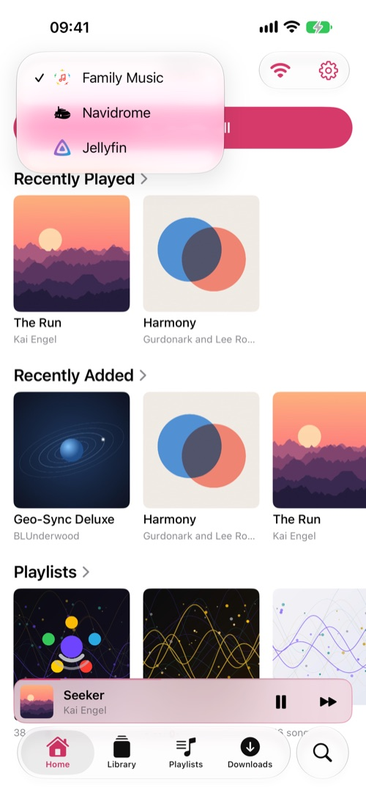

# Getting started
{: .no_toc }

1. TOC
{:toc}

## The first screen

The first screen offers two ways in: an account on own.audio's hosted service, or a server of
your own.

### No server? Use own.audio

The card at the top is for someone without a server. own.audio keeps your music for you.

- **Create an own.audio Account** asks for **Your Name**, **Email** and a **Password** of at
  least 12 characters (a few words are fine), then **Create Account**. The app signs in to the
  new account straight away. own.audio emails you a link to confirm the address.
- **Sign In** fills in own.audio's address in the form below, for an account you already have.
- **Try the Demo Library** signs in to a shared own.audio server with sample music, with no account
  needed. The server is called **own.audio demo** in the app. Remove it in Settings when you
  add your own.

### Or connect your own server

For a server you run yourself, fill in:

- **Server address**: for example `music.example.com`, or an address on your home network such
  as `192.168.1.10:4533`. Without `http://` or `https://`, the app tries https first and then
  http, so a server at home works as you type it.
- **Username** and **Password**. For own.audio, use your account's email and password.
  Jellyfin allows accounts with no password, so the password can be empty.
- **Name (optional)**: what the server is called in the app.

Then tap **Connect**. The app finds out by itself whether the server is own.audio, Subsonic or
Jellyfin, and checks the sign-in before it saves anything.

Your sign-in stays in the device's Keychain. A Subsonic server gets a one-time token made from
the password with each request; Jellyfin and own.audio give the app a token, and the password
is not kept.

### Sign in with Apple or Google

When the address you typed is an own.audio server that takes Apple or Google sign-in, the
buttons **Sign in with Apple** and **Continue with Google** appear under the form, with the note
"Or sign in with the Apple or Google account you use on this own.audio server." Use the same way
you signed up.

### Two-factor sign-in

If your own.audio account has two-factor sign-in on, the app asks for a second step after the
password: **Two-Factor Sign-In**. Enter the code your authenticator app shows, or one of your
recovery codes, and tap **Sign In**.

### Quick Connect (Jellyfin)

**Sign In with Quick Connect (Jellyfin)** signs in without typing a password here. Type the
server address, tap the button, and the app shows a code. Enter it in a Jellyfin
app where you are already signed in, under Quick Connect in your user settings. The app waits
("Waiting for approval…") and signs in once you approve. If the server has Quick Connect turned
off, the app says so; an administrator can turn it on in the Jellyfin dashboard.

## The tabs

Once a server is added, the app has five tabs:

- **Home**: **Shuffle All**, what you played recently, what was added, and your playlists. See
  [Library](library.md#home).
- **Library**: artists, albums, songs, genres, favorites, and concerts where the server has
  them. See [Library](library.md).
- **Playlists**: see [Playlists](playlists.md).
- **Downloads**: what is on the phone. See [Downloads and offline](downloads.md).
- **Search**: see [Search](search.md).

While something plays, the mini player sits above the tab bar. Settings is the gear at the top
right of **Home**.

## Several servers

You can add as many servers as you like: in Settings, under **Servers**, tap **Add a Server**.
The form is the same as on the first screen, plus a hint for Quick Connect.

The library shows one server at a time, the *selected* one, marked with a checkmark in the
server list. To switch:

- on **Home**, tap the server menu at the top left (it appears once you have more than one
  server) and pick another;
- or open the server in Settings and tap **Use This Server**.

Switching starts every tab afresh with the other server's library. What is already in the
queue keeps playing, whichever server it came from.

{: width="300"}

Each server in the list shows its kind (own.audio, Subsonic or Jellyfin) and the account you
signed in with. Swipe a server to **Remove** it. Removing a server deletes its downloads from
the phone; nothing changes on the server.

## The server's page

Tap a server in Settings to open its page.

**Status.** The top line says whether the app is connected and how: **Connected · Home
network**, **Connected · VPN** or **Connected · Internet**, with the address in use. **Check
Now** asks the server again and says what it found: it answers and accepts the sign-in, it
refuses the sign-in, or no address answers.

**Account.** "Signed in as" your username. **Sign In Again** asks for the password again (or
Apple or Google, if that is how you signed up), for example after you changed the password. If
the server stopped accepting the sign-in, the page says "The server no longer accepts this
sign-in." Signing in again keeps your downloads and the library on the phone.

On own.audio, **Delete Account…** deletes your account on that server for good, with everything
you added to it: music, audiobooks, podcasts, playlists and your listening history. What others
in your family added stays with them. The app asks before it does anything.

**own.audio only:** **Family**, **Devices** and **Listening**. See [Family](family.md).

**Server**, **Talks Through** and **Name.** The kind of server, and how the app talks to it:
**own.audio · own API**, **own.audio · Subsonic API**, **Subsonic API** or **Jellyfin API**. An
own.audio server that shows **Subsonic API** was added before the app spoke own.audio's own
API, or is an older server; sign in again to switch, and the library on the phone then stays up
to date within seconds. Tap **Name** to rename the server.

**Music Library… (Jellyfin).** A Jellyfin server can hold several music libraries. Pick one, or
**All Music Libraries**.

**Identify Library (own.audio).** Shown when the server offers it. See [Identify](identify.md).

**Library on This Device.** The app keeps a list of everything on the server, without the
music itself, so albums open and the library can be browsed offline. It shows the number of
songs and albums and when it was last updated. It is updated in the background on Wi-Fi; **Update
Now** does it at once.

**Remove Server**, at the bottom.

### Addresses

A server can have more than one address: one on your home network, one through a VPN such as
Tailscale, and a public one. Under **Addresses**, each address shows where it reaches the
server (**Home network**, **VPN** or **Internet**) and where it came from (**added with** the
server, **from the server**, or **added by you**).

- **Add Address** adds another one, for example `http://192.168.1.20:4533`.
- Swipe an address, or open its menu, to remove it. The address you added the server with can't be removed.

Under **Connection**, **Automatic** lets the app pick: on each network it uses the fastest
address that answers as this server, and remembers which one worked where. You can also pick
one address to always use.

own.audio and Jellyfin servers tell the app their addresses and an identity, so an address that
answers as a different server is never used. Subsonic servers don't say which addresses they
have, so add them yourself; the app checks each one with your sign-in.
