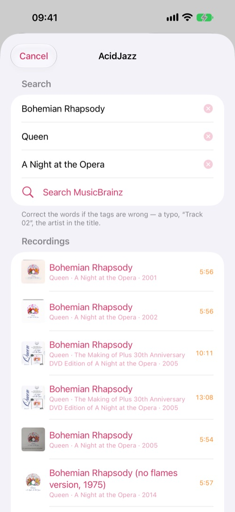

# Identify (own.audio)
{: .no_toc }

1. TOC
{:toc}

On an own.audio server that offers it, the app can have the server compare your songs with
[MusicBrainz](https://musicbrainz.org) and put their titles, albums and artists right. Nothing
changes until you accept it, your files never change, and anything can be undone. On other
servers, and on own.audio servers without it, none of this is shown.

You can identify only your own songs: what you added to the library, not what someone in your
family shared with you.

## Identify the whole library

Open **Identify Library**: under the grid in the **Library** tab on iPhone, or on the server's
page in Settings.

- If the server has several music folders, pick **Whole library** or one folder under
  **Identify**.
- Tap **Identify Whole Library** (or **Identify This Folder**).

The server works in the background. MusicBrainz answers about one album a second, so a large
library takes a while. If MusicBrainz is busy, the run waits and carries on by itself.

On a server that charges for identifying, the app first says how many songs there are and what
it can cost at most, and asks you to **Start**. You pay only for songs MusicBrainz finds, once
per song, and correcting them later is free.

**Runs** lists every run with its state (**Queued**, **Identifying**, **Waiting**, **Ready**,
**Failed**) and counts: sure, to review, not found, accepted.

## Reviewing a run

Open a run to see what it proposes, grouped by album, under four tabs:

- **To Review**: matches to look at one by one;
- **Sure**: matches the server is sure of. **Accept … Sure Matches** takes them all at once;
- **Not Found**;
- **Done**: what you accepted or rejected.

For a whole album, its menu has **Accept All … Songs** and **Other Edition…**: the other
releases of the album the server found, with how many of their tracks matched, to match the
whole album to one of them. Where the server can, you can also correct the **Album** or
**Artist** and **Search MusicBrainz** again.

For one song, swipe it to **Accept** or **Reject**, or **Undo** what you decided. Its menu also
has **Other Recording…**. A song can carry a note on why it needs a look, such as **Weak
match**, **Other album**, **Other artist**, **Not on this edition** or **Two files, one track**.

The run's **More** menu has **Undo Run**, which puts every song this run identified back the
way it was, and **Delete Run**, which removes the run and its proposals; what you accepted
stays.

{: width="300"}

## Identify one song, album or artist

- A song: **Identify…** in its menu, or **Identify** in the player's tools row for the song
  playing. You get a search with the song's title, artist and album filled in. Correct the
  words if the tags are wrong (a typo, "Track 02", the artist in the title) and tap **Search
  MusicBrainz**. Pick the right one under **Recordings**, or paste a link or ID from
  musicbrainz.org under **Or Paste a Link** and tap **Use This Recording**.
- An album: **Identify Album** in the album's **More** menu.
- An artist: **Identify Artist** in the artist's **More** menu.

An album or artist starts a run for just those songs, which you review as above.

## Undo

**Undo Identify…** in a song's menu (or in the player's **Identify** menu) puts the song back as
its file says, with no MusicBrainz match.
