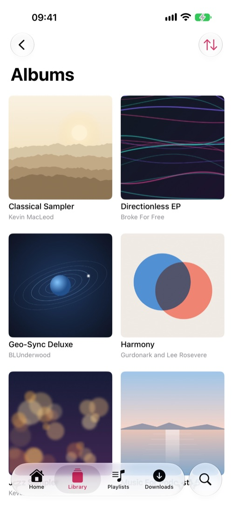
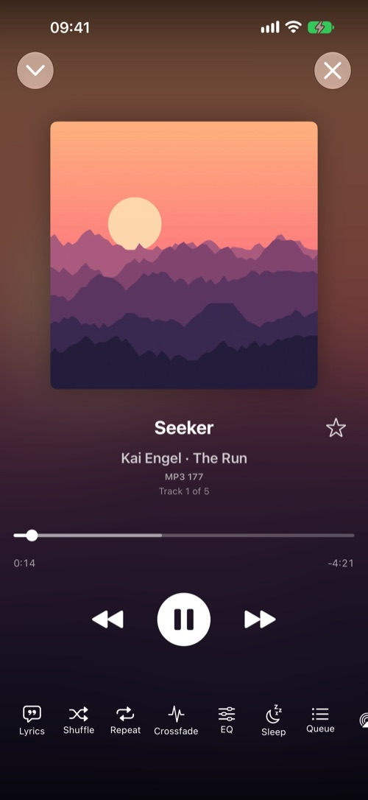
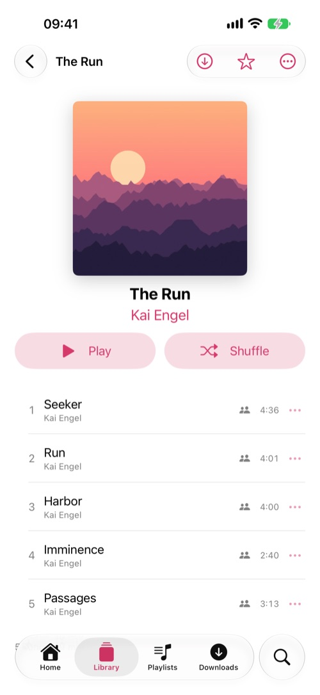
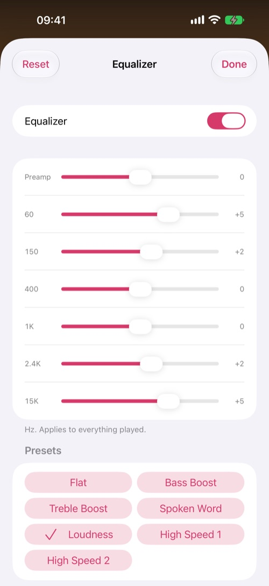

# own.audio Music

own.audio Music is a music player for iPhone and iPad that plays from your own server. It
works with:

- **own.audio** servers, the hosted service or one you run yourself;
- **Navidrome**;
- **Jellyfin**.

You can add several servers and switch between them. The app is free, has no in-app
purchases, and needs no account with us. It runs on iOS 18 and later. On the home screen it is
called **own.music**.

{: width="200"}
{: width="200"}
{: width="200"}
{: width="200"}

- [Download on the App Store](https://apps.apple.com/app/own-audio-music/id6821355751)
- [Privacy policy](https://github.com/own-audio/music-ios/blob/main/PRIVACY.md)
- [Report a problem or ask a question](https://github.com/own-audio/music-ios/issues)

## What each server can do

The app asks each server what it can do and hides what it can't, so you never see a button
that does nothing. Most of the app works the same everywhere:

| Feature | own.audio | Subsonic / Navidrome | Jellyfin |
|---|---|---|---|
| Browse, search, play, queue | Yes | Yes | Yes |
| Playlists: create, rename, add, remove, delete | Yes | Yes | Yes |
| Favorite songs, albums and artists | Yes | Yes | Yes |
| Star ratings and **Top Rated** | Yes | Yes | No |
| Lyrics | Yes | Where the server has them | Yes |
| Smaller streams on mobile data (**Saver**) | Yes | Where the server can make them | Yes |
| Downloads and offline mode | Yes | Yes | Yes |
| Reporting plays | Yes | Yes | Yes |
| **Instant Mix** | No | No | Yes |
| Choosing one of several music libraries | No | No | Yes |
| **Quick Connect** sign-in | No | No | Yes |
| Sign in with Apple or Google, two-factor codes | Where the server offers it | No | No |
| Smart playlists | Yes | No | No |
| Family sharing | Yes | No | No |
| Choosing covers and artist pictures | Yes | No | No |
| Concerts (a whole show in one file) | Where the server keeps them | No | No |
| Identify the library with MusicBrainz | Where the server offers it | No | No |
| Devices, listening statistics, deleting your account | Yes | No | No |
| Library on the phone that follows changes within seconds | Yes | No | No |

The own.audio features need the app to talk to own.audio's own API. A server you added in an
older version, or an older own.audio server, may still go through its Subsonic API; the
server's page says so, and **Sign In Again** switches it over. See
[Getting started](getting-started.md#the-servers-page).

## In this guide

- [Getting started](getting-started.md): adding a server, the demo, signing in, several servers
- [Library](library.md): Home, artists, albums, songs, genres, concerts
- [Search](search.md)
- [The player](player.md): controls, lyrics, queue, shuffle, repeat, crossfade, equalizer, sleep timer
- [Playlists and smart playlists](playlists.md)
- [Favorites and ratings](favorites.md)
- [Downloads and offline](downloads.md)
- [Identify (own.audio)](identify.md)
- [Family (own.audio)](family.md)
- [Settings](settings.md)
- [Lock screen, widgets, Siri, AirPlay and CarPlay](system.md)
- [iPad and Mac](ipad.md)
- [Privacy](privacy.md)

The app is open source under the MPL-2.0:
[github.com/own-audio/music-ios](https://github.com/own-audio/music-ios).
