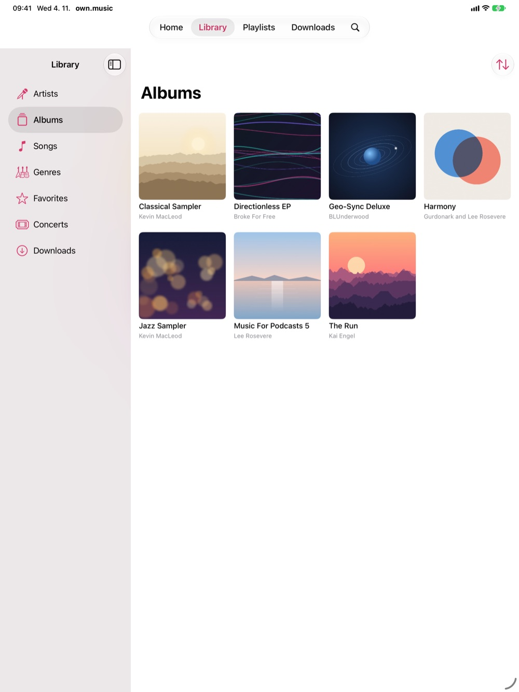
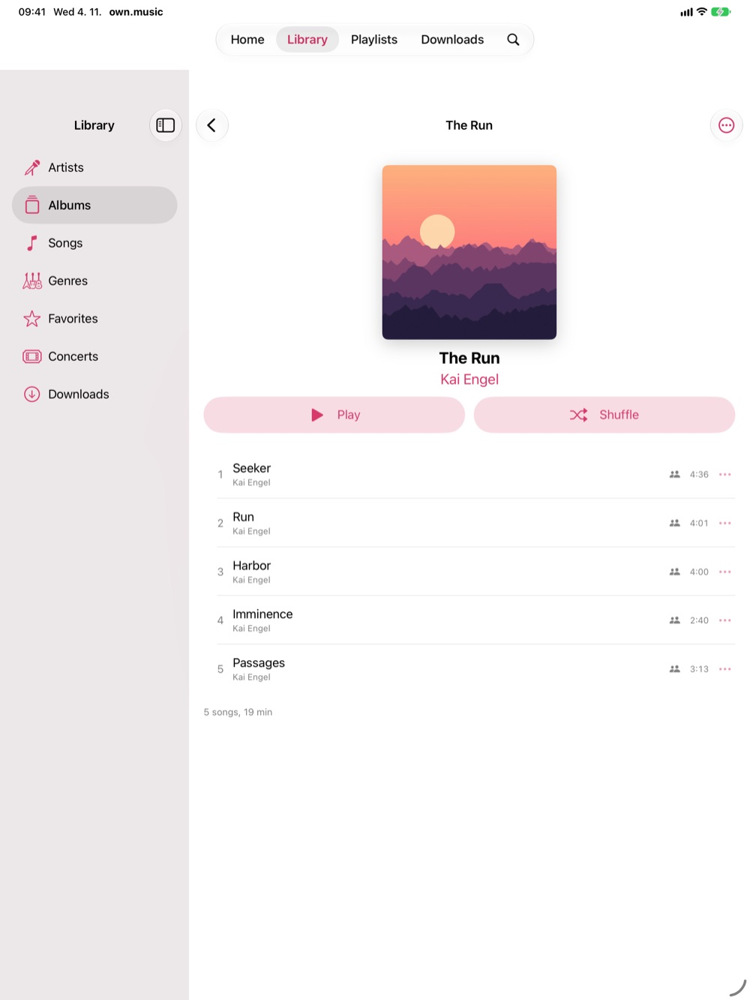

# iPad and Mac

The app works the same on iPad, in any orientation, with a few differences in layout.

{: width="600"}

- The tabs are at the top of the screen.
- **Library** has a sidebar: **Artists**, **Albums**, **Songs**, **Genres**, **Favorites**,
  **Concerts** (own.audio, when the server keeps them) and **Downloads**. The section you pick
  opens beside it. The button at the top of the sidebar hides or shows it.
- On an album page, the download button, the star and the album's menu are together in one
  **More** menu at the top right, with **Download** (or **Remove Download**) and **Favorite
  Album** at the top of it.
- **Identify Library** is on the server's page in Settings (on iPhone it is also under the
  Library grid).

{: width="600"}

The player keeps its controls in a column in the middle of the screen, with a larger cover.

{: width="600"}

## Keyboard

With a keyboard attached to the iPad, or on a Mac:

| Key | Does |
|---|---|
| Space | Play or pause |
| ⌘→ | Next song |
| ⌘← | Previous song |
| Esc | Closes the full player |

While you type in a search field, the keys type as usual.

## On a Mac

The iPad app also runs on Macs with Apple silicon. It looks and works as on iPad, with these
differences:

- What you would swipe in a list (signing out a device, withdrawing an invitation, removing an
  address) is also in the row's menu: right-click it, or touch and hold it on iPhone and iPad.
- A Mac has no mobile data, so **Download on Wi-Fi Only** and the **Streaming** section are not
  in Settings.
- The own.audio server lists the app as a Mac in **Devices**.
