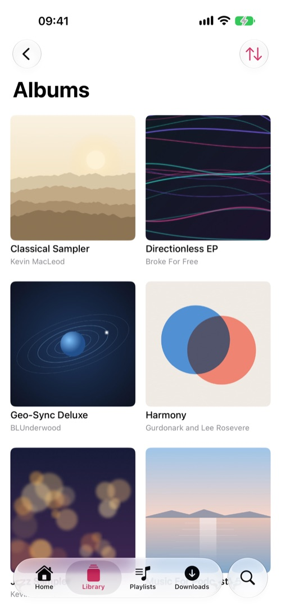
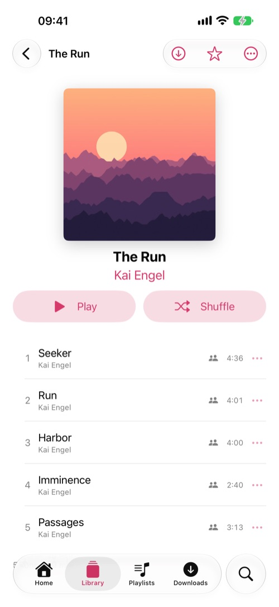

# Library
{: .no_toc }

1. TOC
{:toc}

## Home

**Home** is the tab the app opens on.

- **Shuffle All** plays a random hundred songs from the whole library. The server picks them,
  so it works the same for any size of library.
- **Recently Played** and **Recently Added**: albums in rows you scroll sideways. Tap a title
  to see the full list.
- **Playlists**: your playlists, in the same kind of row.

At the top: the server menu (with more than one server, see
[Getting started](getting-started.md#several-servers)), the **Offline Mode** button (the
Wi-Fi symbol, see [Downloads and offline](downloads.md#offline-mode)) and **Settings** (the
gear).

Pull down to refresh. Offline, Home shows **Downloaded Albums** instead of what was added, and
**Shuffle All** shuffles what is downloaded.

## The Library tab

On iPhone, **Library** is a grid of sections: **Artists**, **Albums**, **Songs**, **Genres**,
**Favorites**, and **Concerts** when the server keeps them. The arrow at the top right opens
**Downloads**. On an own.audio server that offers it, **Identify Library** is under the grid
(see [Identify](identify.md)).

On iPad the sections are a sidebar; see [iPad](ipad.md).

### Artists

Every artist, with a picture where the server has one and the number of albums. Use **Filter
Artists** at the top to narrow the list.

### Albums

{: width="300"}

Every album as a grid of covers. The sort button at the top right orders them:

- **By Title**, **By Artist**
- **Recently Added**, **Recently Played**, **Most Played**
- **Random**
- **Favorites**
- **Top Rated**, on servers with ratings (own.audio and Subsonic, not Jellyfin)

More albums load as you scroll.

### Songs

Every song, loaded a page at a time as you scroll, with **Play** and **Shuffle** at the top.

### Genres

Every genre, with its number of albums and songs. A genre opens its albums, and **Shuffle**
plays up to a hundred random songs of that genre.

### Favorites

What you starred, split into **Songs**, **Albums** and **Artists**. See
[Favorites and ratings](favorites.md).

### Concerts (own.audio)

A concert is a whole show recorded as one file, with a chapter where each song starts.
**Concerts** shows them, newest first, on own.audio servers that keep them; on other servers
the section isn't there.

When a concert plays, the player shows **Song 2 of 14** (for example) under the title. Tap it
for the list of songs in the show and tap one to jump there; **Previous** and **Next** move
between the songs too. A concert starts again where you left it, on any device signed in to the
same account, unless you were in its last half minute.

If the concert is yours, **Edit** in that list opens **Edit Songs**: change a song's name or
start time (written as `9:26` or `1:02:03`), set a start to where the player is now with the
arrow (**Start Here**), **Add a Song Here**, or swipe to delete one. **Save** stores them on the
server, which keeps them from then on, whatever the file says.

## An album

{: width="300"}

The album page shows the cover, title, artist (tap it to open the artist) and year, then
**Play** and **Shuffle** and the songs. An album with several discs is split into **Disc 1**,
**Disc 2** and so on. At the bottom: the number of songs and the running time.

At the top right:

- **Download** (the arrow): downloads the album. While it downloads it shows how far it got;
  once done, a check. Tap the check for **Remove Download**.
- The star: **Favorite Album** or **Unfavorite Album**.
- **More** (the circle with three dots):
  - **Play Next** and **Add to Queue**
  - **Rate**, on servers with ratings
  - **Instant Mix** (Jellyfin): songs like this album, picked by the server
  - **Add Album to Playlist…**
  - **Choose Album Cover…** (own.audio, when songs on the album are yours): pick a picture from
    your photos; the app makes it smaller and sends it to the server
  - **Share My Songs with the Family** or **Stop Sharing My Songs** (own.audio with a family):
    your own songs on the album, all at once. See [Family](family.md)
  - **Identify Album** (own.audio with Identify). See [Identify](identify.md)

## An artist

The artist page shows the artist's picture and name, **Play** and **Shuffle** for all their
albums, and the albums as a grid. At the top right: the star (**Favorite Artist**) and, on
own.audio, **More** with **Choose Picture…** and **Identify Artist**.

## Songs in a list

Each song row shows its number (or cover), title, artist and length. Small icons after the
title:

- people: shared with the family (own.audio);
- a filled arrow: downloaded;
- a star: a favorite.

The song playing has a speaker instead of its number. Tap a song to play it and the rest of
the list after it.

### A song's menu

Tap **⋯** on the right of a song, or press and hold the song:

- **Play Next**: after the song playing now.
- **Add to Queue**: at the end of the queue.
- **Favorite** or **Unfavorite**.
- **Rate**, on servers with ratings. See [Favorites and ratings](favorites.md).
- **Instant Mix** (Jellyfin, online).
- **Add to Playlist…**: one of your playlists, or **New Playlist…**.
- **Choose Cover…** (own.audio, your own songs).
- **Share with the Family** or **Stop Sharing** (own.audio, your own songs, with a family).
- **Identify…** and **Undo Identify…** (own.audio with Identify, your own songs). See
  [Identify](identify.md).
- **Download** or **Remove Download**.
- **Remove from Playlist**, in a playlist of yours.

Actions that need the server, such as sharing or choosing a cover, are hidden while you are
offline. A favorite, a rating or songs added to a playlist while offline are kept and sent when
the server can be reached again.
