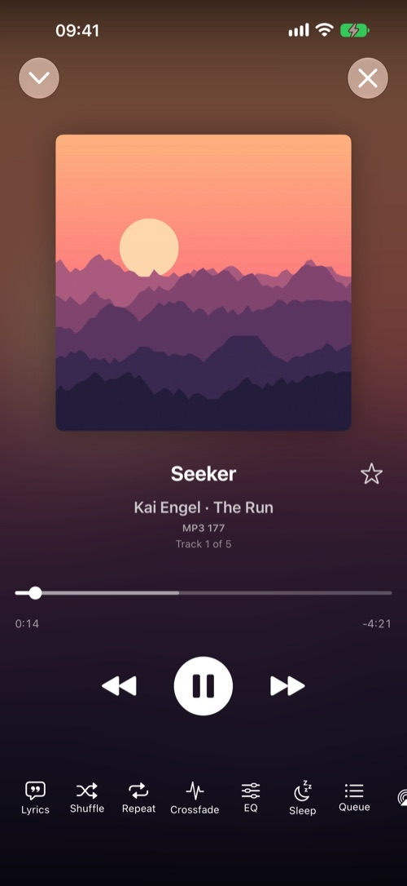
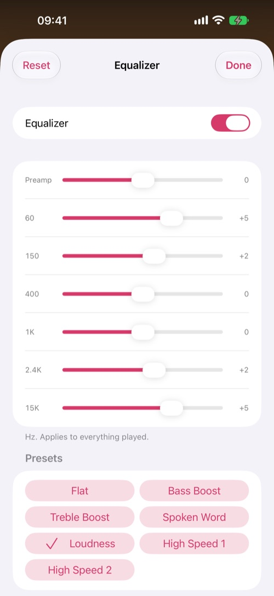

# The player
{: .no_toc }

1. TOC
{:toc}

## The mini player

While something is playing, a bar sits above the tab bar with the cover, title and artist,
**Play**/**Pause** and **Next**. A thin line along its top shows how far the song has got; for a
song still arriving from the server, the part already downloaded is drawn lighter. Tap the bar
to open the full player.

When you open the app again later, the bar shows the song you were listening to with a play
symbol. Tap it to play the queue from where you left off.

## The full player

{: width="300"}

From top to bottom:

- The down arrow at the top left closes the player; the music goes on. The **✕** at the top
  right stops playback.
- The cover. Swipe it left for the next song, right for the previous one.
- The title (a long one scrolls once), and the star to make the song a favorite.
- The artist and album.
- The format, for example **FLAC · 44.1 kHz · 16-bit** for lossless or **MP3 320** for a lossy
  file with its bitrate. When volume leveling changes the song's volume, the change is added,
  such as **+2.5 dB**.
- **Track 1 of 5**: where the song is in the queue. In a concert, **Song 2 of 14** instead (see
  [Concerts](library.md#concerts-ownaudio)).
- The position bar. Drag it to move in the song. For a song that is still streaming, the part
  already downloaded is drawn lighter.
- **Previous**, **Play**/**Pause**, **Next**. More than three seconds into a song, **Previous**
  goes back to its start; within the first three seconds it goes to the song before.

Songs play gapless by default: one runs into the next with no silence, so live and classical
albums flow as recorded. A song starts playing while it is still arriving; if it can't be
played, the reason is shown under the controls.

### The tools row

Under the controls is a row of tools. If it doesn't fit, scroll it sideways.

| Tool | What it does |
|---|---|
| **Lyrics** | Opens the song's lyrics. |
| **Shuffle** | Shuffles the queue, or puts it back in order. |
| **Repeat** | Off, then repeat all, then repeat one song, then off again. |
| **Crossfade** | Turns crossfade on or off and sets its length. |
| **EQ** | Opens the equalizer. |
| **Sleep** | Opens the sleep timer. |
| **Queue** | Opens the queue. |
| **Identify** | own.audio with Identify, on your own songs: **Identify…** and **Undo Identify…** for the song playing. See [Identify](identify.md). |
| AirPlay | Picks where the sound plays: the iPhone, headphones, an AirPlay speaker. |

A tool that is on (shuffle, repeat, crossfade, the equalizer, a running sleep timer) is drawn
in the accent color.

## Lyrics

**Lyrics** shows the words of the song playing. Synced lyrics follow the music: the current line
is bright and kept in the middle, and a tap on a line jumps to it. Plain lyrics just scroll.

When the server has more than one version (another language, or both synced and plain), pick it
at the top left. If there are none, the app says "The server has no lyrics for this song."
Servers read lyrics from the file's tags or from an `.lrc` file next to it. On Subsonic servers
it depends on the server whether it gives lyrics at all.

## The queue

**Queue** lists:

- **Now Playing**;
- **Up Next**: tap a song to jump to it. Tap **Edit** to drag songs into another order, and
  swipe a song to remove it;
- **Played**: what played before, grayed; tap one to go back to it.

To add to the queue from anywhere, use **Play Next** or **Add to Queue** in a song's or an
album's menu. Starting an album, a playlist or a list of songs replaces the queue.

## Crossfade

**Crossfade** makes songs fade into each other near the end instead of playing back to back.
With it on, **Fade** sets the length, from 1 to 12 seconds (4 by default). It is off by default.
The same setting is in [Settings](settings.md).

## Equalizer

{: width="300"}

A six-band equalizer: **Preamp** and bands at 60, 150, 400 Hz, 1K, 2.4K and 15K, each from
−12 to +12 dB. Turn it on with **Equalizer** at the top. It applies to everything played.

**Presets**: **Flat**, **Bass Boost**, **Treble Boost**, **Spoken Word**, **Loudness**, **High
Speed 1** and **High Speed 2**. The chosen one has a checkmark; once you move a slider yourself,
the header says **Custom**. **Reset** puts everything back to flat. It is off by default.

## Sleep timer

**Sleep** stops playback after **5 minutes**, **15 minutes**, **30 minutes**, **45 minutes** or
**60 minutes**, or at the **End of Track**. While it runs, the cover shows the time left (or
"End of track"), and the sleep timer shows **Time remaining**, **+10 minutes** and **Turn Off
Sleep Timer**.

## Volume leveling

Volume leveling uses the ReplayGain values in your files, so a quiet song and a loud one play at
a similar volume. On Jellyfin it uses the loudness Jellyfin measured. It is set in
[Settings](settings.md#playback): **Same for Every Song** (the default), **Same for Every
Album**, which keeps an album's own quiet and loud moments, or **Off**. Songs without the values
play unchanged.
