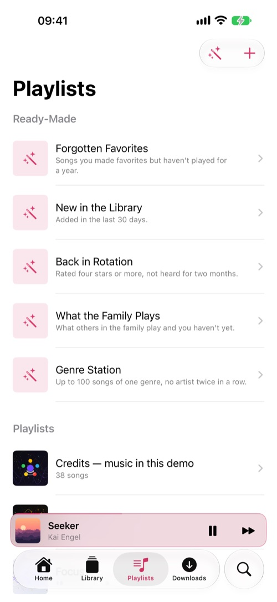

# Playlists and smart playlists
{: .no_toc }

1. TOC
{:toc}

## Playlists

The **Playlists** tab lists the server's playlists, with their number of songs. A playlist
someone else made says whose it is ("by …").

- **+** at the top right makes a new, empty playlist: **New Playlist**, give it a name, **Create**.
- To add songs, use **Add to Playlist…** in a song's menu, or **Add Album to Playlist…** in an
  album's menu. The sheet lists your own playlists and **New Playlist…**, which makes one with
  those songs in it.

### A playlist

A playlist shows its cover, name and description, **Play** and **Shuffle**, and its songs. At
the top right:

- **Download** (the arrow): keeps the playlist on the phone. See [Downloads](downloads.md).
- On your own playlists, the **⋯** menu (**Edit Playlist**):
  - **Rename**
  - **Choose Cover…** (own.audio)
  - **Share with the Family** or **Stop Sharing** (own.audio with a family)
  - **Delete Playlist**. This deletes it on the server, for every app that uses it.

In your own playlists, swipe a song or use **Remove from Playlist** in its menu to take it out.
A playlist can hold the same song twice.

Playlists live on the server, so every app signed in to the same account sees the same ones.

## Smart playlists (own.audio)

{: width="300"}

On an own.audio server, the Playlists tab also has smart playlists. A smart playlist is a rule
rather than a list: each time you open it, the server chooses songs that fit, from your own
listening.

**Ready-Made** are the server's own rules:

| Name | What it picks |
|---|---|
| **Forgotten Favorites** | Songs you made favorites but haven't played for a year. |
| **New in the Library** | Added in the last 30 days. |
| **Back in Rotation** | Rated four stars or more, not heard for two months. |
| **What the Family Plays** | What others in the family play and you haven't yet. |
| **Genre Station** | Up to 100 songs of one genre, no artist twice in a row. Choose the genre first. |

**Smart Playlists** are the ones you saved.

### A smart playlist

It shows the songs chosen this time and a line such as "25 songs, chosen from 340 that fit". Tap
a song to play from it. At the top right:

- **New Selection** (the circular arrow) asks for a new choice.
- **Smart Playlist Actions** (**⋯**):
  - **Edit Rule** (your own);
  - **Save as Playlist**: keeps this choice as an ordinary playlist. It won't change from then
    on;
  - **Delete Smart Playlist** (your own). Playlists made from it stay;
  - on a ready-made one, **Save as Smart Playlist**: a copy of its rule you can change.

If nothing in the library fits the rule at the moment, it says **Nothing Fits Right Now**.

### Making or editing a rule

The magic-wand button at the top of the Playlists tab opens **New Smart Playlist**. While you
change the rule, the editor shows how many songs fit.

| Setting | Choices |
|---|---|
| **Name** | |
| **Share with the Family** | Shared, it is a rule rather than a list: each member gets their own selection, from what they have listened to. |
| **Genres** | **All**, or the genres you pick. |
| **Favorites Only** | On or off. |
| **Rating at Least** | **Any**, or one to five stars. |
| **Not Played For** | **Any Time**, **A Month**, **Three Months**, **Half a Year**, **A Year**. |
| **Added in the Last** | **Any Time**, **Week**, **Month**, **Three Months**. |
| **Played by Others, Not by Me** | On or off. |
| **Limit the Tempo** | **From** and **To**, in BPM, 40 to 240. |
| **Energy** | **Any**, **Calm**, **Moderate**, **Energetic**. |
| **Length** | A number of **Songs** (10 to 500) or **Minutes** (15 to 1440). |
| **Order** | **Mixed, Favorites More Often**, **Best First**, **Longest Unplayed First**, **Random**. |
| **Energy Over Time** | **Even**, **Warm Up, Steady, Cool Down**, **Building Up**, **Winding Down**. |
| **At Most … per Artist** | 1 to 20. |
| **Never the Same Artist Twice in a Row** | On or off. |

Only songs the server has analysed have a tempo and an energy; with **Limit the Tempo** or
**Energy** set, the others are left out.

Tap **Save**.
